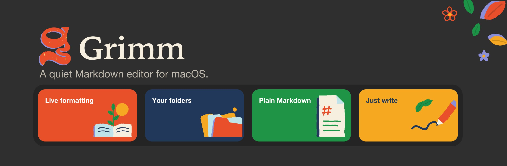

# Grimm

A quiet Markdown editor for macOS. You type Markdown and the page formats itself as you go, with no preview pane and no toolbar full of buttons.

Your notes stay ordinary `.md` files on your own disk. There is no account, no library to import into and no format of its own.

## Download

Get the latest `.dmg` from the [Releases page](https://github.com/deecaulcrick/grimm-md/releases/latest). Grimm is a universal app for Apple silicon and Intel Macs, and it keeps itself up to date after that.

The app is not notarised by Apple, so macOS may block it the first time you open it. If it does, allow it under **System Settings → Privacy & Security → Open Anyway**.

## What it does

- **Live formatting.** Headings, lists, quotes, bold, italic and code take shape as you type them.
- **Checkboxes.** Type `[]` at the start of a line for a task you can tick.
- **Insert menu.** Type `/` for tables, code blocks, images, dividers and embeds.
- **Drag anything.** Move blocks and list items by their grip, reorder table rows and columns, reorder tabs, and drag files from the sidebar into a pane.
- **Tabs and split view.** Keep several notes open, two side by side.
- **Outline.** Jump between the headings of a long note.
- **Link cards.** A URL on a line of its own becomes a preview card. The file still contains just the link.
- **HTML embeds.** A code block with the language `embed` is rendered as live HTML in a sandboxed frame.
- **Twelve themes**, six light and six dark, with a serif, sans or mono page font, three text sizes, and a centred or full-width page.
- **Autosave.** Once a note has a file, it is saved as you write.
- **Plain Markdown underneath.** Press ⌘/ to edit the raw source at any time.

The app opens with a short welcome note and a full feature list on first launch; both are under the **Help** menu afterwards.

## Shortcuts

| Shortcut   | Action                        |
| ---------- | ----------------------------- |
| ⌘N         | New tab                       |
| ⌘W         | Close tab                     |
| ⇧⌘] / ⇧⌘\[ | Next / previous tab           |
| ⇧⌘\\       | Toggle split view             |
| ⌘O / ⇧⌘O   | Open file / folder            |
| ⌘S / ⇧⌘S   | Save / Save As                |
| ⌘/         | Toggle page ↔ Markdown source |
| ⌘\\        | Toggle sidebar                |

⌘-click a file in the sidebar to open it in the other pane.

## Brand

The icon, the onboarding drawings and the share server's notice pages all come from one set of hand-drawn shapes in [src/illustrations.ts](src/illustrations.ts), in Grimm's palette:

| Orange    | Navy      | Green     | Yellow    | Lavender  | Sky       | Cream     |
| --------- | --------- | --------- | --------- | --------- | --------- | --------- |
| `#E8502A` | `#22385A` | `#1F9446` | `#F6A821` | `#8B8FD9` | `#BEE4E9` | `#F6EFDF` |

`npm run brand` redraws the app icon (and every size Tauri needs), the in-app mark, the share server's link preview, and the files in [brand/](brand): the social card, the README banner, the DMG background and a sticker.

